<picture>
<source media="(prefers-color-scheme: light)" srcset="docs/readme/hero-light.svg">

</picture>

<p align="center">
<a href="#get-it-running"><picture><source media="(prefers-color-scheme: light)" srcset="docs/readme/pill-install-light.svg"></picture></a>
<a href="#how-your-vault-is-sealed"><picture><source media="(prefers-color-scheme: light)" srcset="docs/readme/pill-security-light.svg"></picture></a>
<a href="https://youtu.be/DxMICmnFs_Y"><picture><source media="(prefers-color-scheme: light)" srcset="docs/readme/pill-demo-light.svg"></picture></a>
<a href="https://zeromarks.net/bunker/"><picture><source media="(prefers-color-scheme: light)" srcset="docs/readme/pill-site-light.svg"></picture></a>
</p>

<p align="center">
<b>Your passwords, on your machine. Nowhere else.</b><br>
An offline password and notes vault that lives in one folder on your computer.<br>
No account. No cloud. No sync. No telemetry. Free and source-available.
</p>

> [!NOTE]
> **A security-hardened 2.0 release is in final review** on the [`hardening/v2.0`](https://github.com/ZeroMarks/BUNKER2.0/tree/hardening/v2.0) branch: a vault that is never lost to errors, a `requirements.txt` with hash-locked installs, a test suite, and a published [threat model](https://github.com/ZeroMarks/BUNKER2.0/blob/hardening/v2.0/docs/THREAT_MODEL.md). This page describes the current release on `main`.

<br>


## What it is

BUNKER is a password and notes manager for one person and one machine. Your vault is a file next to the app, encrypted with **AES-256-GCM** under a key stretched from your master password with **Argon2id**. It never leaves your device, because there is nowhere for it to go.

- **Encrypted vault** for passwords, usernames, emails and notes
- **Password generator** that copies to your clipboard and clears it after 30 seconds
- **Auto-logout** after inactivity
- **Export and import** of profiles and notes, for backups
- **Failed-login limit:** too many wrong master passwords and the vault is wiped
- **IP display** you can turn on or off


## How your vault is sealed

<picture>
<source media="(prefers-color-scheme: light)" srcset="docs/readme/sealed-light.svg">

</picture>

| | |
|---|---|
| **Cipher** | AES-256-GCM, a fresh random 96-bit nonce for every encryption |
| **Key derivation** | Argon2id (100 MiB memory, 3 passes), then PBKDF2-HMAC-SHA3-256 (110,000 iterations) |
| **Master password** | Never stored. BUNKER checks it by decrypting a verifier |
| **Files** | `Bunker.mmf` (vault), `bunker.salt`, `bunker.cfg`. You need all three, so back them up together |
| **Network** | Works with the network off. No cloud, no sync, no update check. The only lookups show your public IP: the IP display (when on) and the System info screen |
| **Forgot your master password?** | Nobody can open the vault, including us |

**Keep a backup.** The self-destruct is a deliberate "burner vault" design, and in this release some errors can trigger it too, so keep an encrypted export of anything you can't lose. Version 2.0 limits the wipe to wrong master passwords only. The failed-login limit stops guessing at your keyboard but not against a *copy* of your files, so use a long passphrase.

## Get it running

<picture>
<source media="(prefers-color-scheme: light)" srcset="docs/readme/install-main-light.svg">

</picture>

**1. Python 3.** Get it from [python.org/downloads](https://www.python.org/downloads/) (Windows `.exe`, macOS `.pkg`, or your Linux package manager).

**2. Download BUNKER** with `git clone https://github.com/ZeroMarks/BUNKER2.0`, or **Code → Download ZIP** above, and open a terminal in that folder.

**3. Install the dependencies:**

```bash
pip install inputimeout keyboard cryptography pyperclip psutil requests argon2-cffi
```

**4. Launch:**

```bash
python3 BUNKER.py
```

- **Try the demo:** keep the included `Bunker.mmf` and log in with the demo password **`rootroot`**.
- **Make your own vault:** delete `Bunker.mmf` from the folder first, then run BUNKER and follow the setup.

Full screen is recommended. If you see an import error, install the missing package with `pip install <name>`; for anything else, email **support@zeromarks.net**.

## User guide

The complete guide is inside the app: open the 🏚️ **MAIN MENU** 🏚️ and choose the User Guide.

## License

BUNKER is **free and source-available** under the Custom Protective Software License (CPSL) v1.0: you can read every line and use it for personal or internal business use. You may not redistribute or modify it without written permission. It is not "open source" in the OSI sense. Read the [license](LICENSE.txt) for the exact terms.

BUNKER is provided as-is, without warranty; use it at your own risk and keep backups.

## Security

Found a vulnerability? Email **support@zeromarks.net** and please don't open a public issue.

## Made by ZeroMarks

BUNKER was started on May 10, 2024 and reached 2.0 on June 20, 2024. Created by **@RIX**, founder of [ZeroMarks](https://zeromarks.net), a privacy-first software studio making software that minds its own business.

[YouTube](https://www.youtube.com/@ZEROMARKSLLC) · [Reddit](https://www.reddit.com/r/zeromarksllc) · [X](https://x.com/zeromarksvpn) · [TikTok](https://www.tiktok.com/@zeromarksllc) · [Instagram](https://www.instagram.com/zeromarksllc) · [Facebook](https://www.facebook.com/zeromarksllc) · [GitHub](https://github.com/ZeroMarks)

<br>

<picture>
<source media="(prefers-color-scheme: light)" srcset="docs/readme/footer-light.svg">

</picture>
