<picture>
<source media="(prefers-color-scheme: light)" srcset="docs/readme/hero-light.svg">

</picture>

<p align="center">
<a href="#get-it-running"><picture><source media="(prefers-color-scheme: light)" srcset="docs/readme/pill-install-light.svg"></picture></a>
<a href="#how-your-vault-is-sealed"><picture><source media="(prefers-color-scheme: light)" srcset="docs/readme/pill-security-light.svg"></picture></a>
<a href="docs/THREAT_MODEL.md"><picture><source media="(prefers-color-scheme: light)" srcset="docs/readme/pill-threat-light.svg"></picture></a>
<a href="https://zeromarks.net/bunker/"><picture><source media="(prefers-color-scheme: light)" srcset="docs/readme/pill-site-light.svg"></picture></a>
</p>

<p align="center">
<b>Your passwords, on your machine. Nowhere else.</b><br>
An offline password and notes vault that lives in one folder on your computer.<br>
No account. No cloud. No sync. No telemetry. Free and source-available.
</p>

<br>


## What it is

BUNKER is a password and notes manager for one person and one machine. Your vault is a file next to the app, encrypted with **AES-256-GCM** under a key stretched from your master password with **Argon2id**. It never leaves your device, because there is nowhere for it to go. [Watch the demo](https://youtu.be/DxMICmnFs_Y).

- **Encrypted vault** for passwords, usernames, emails and notes, each field sealed on its own
- **Password generator** for strong random passwords
- **Clipboard auto-clear** after 30 seconds and when BUNKER closes
- **Auto-logout** after inactivity (10 s to 1 hour, or off)
- **Encrypted export and import** with a passphrase, for backups
- **Failed-login limit:** 3 wrong master passwords and the vault is wiped. A crash, an error or a damaged file never does that
- **Desktop and narrow-terminal views:** BUNKER suggests one for your screen and asks you to confirm
- **Plain output** for screen readers and logs (`NO_COLOR`, `BUNKER_NO_EMOJI`)


## How your vault is sealed

<picture>
<source media="(prefers-color-scheme: light)" srcset="docs/readme/sealed-light.svg">

</picture>

| | |
|---|---|
| **Cipher** | AES-256-GCM, a fresh random 96-bit nonce for every encryption |
| **Key derivation** | Argon2id (100 MiB memory, 3 passes, 32-byte random salt), then PBKDF2-HMAC-SHA3-256 (110,000 iterations) |
| **Master password** | Never stored. BUNKER checks it by decrypting a verifier |
| **Files** | `Bunker.mmf` (vault), `bunker.salt`, `bunker.cfg`, written owner-only (0600 on macOS/Linux). You need all three, so back them up together |
| **Network** | Works with the network off. No cloud, no sync, no update check. The only lookups show your public IP: the IP display (off by default) and the System info screen |
| **Forgot your master password?** | Nobody can open the vault, including us. Keep an encrypted export as your backup |

**What it protects against, and what it doesn't.** The failed-login limit stops guessing at your keyboard. It does not apply to a *copy* of your vault files, which can be attacked offline, so your master password's length is your real defence: use a long passphrase. Malware running as you can read anything you can; no local password manager can stop that. Every known limit is listed in the **[threat model](docs/THREAT_MODEL.md)**. If BUNKER ever refuses to open your vault, read **[docs/RECOVERY.md](docs/RECOVERY.md)** before doing anything else.

## Get it running

<picture>
<source media="(prefers-color-scheme: light)" srcset="docs/readme/install-light.svg">

</picture>

**1. Python 3.10 or newer.** Get it from [python.org/downloads](https://www.python.org/downloads/) (Windows `.exe`, macOS `.pkg`, or your Linux package manager).

**2. Download BUNKER** with `git clone https://github.com/ZeroMarks/BUNKER2.0`, or **Code → Download ZIP** above, and open a terminal in that folder.

**3. Install the dependencies:**

```bash
pip install -r requirements.txt
```

Want proof nothing was tampered with on the way? `requirements.lock` pins the exact versions CI tested, with SHA-256 hashes:

```bash
pip install --require-hashes -r requirements.lock
```

**4. Launch:**

```bash
python3 BUNKER.py
```

The first run walks you through creating your vault and a master password (8 characters minimum; longer is much better). After that, every launch opens on the **BUNKER ACCESS** page. Full screen is recommended.

<details>
<summary><b>Options</b></summary>

```bash
NO_COLOR=1 python3 BUNKER.py                      # no colours
NO_COLOR=1 BUNKER_NO_EMOJI=1 python3 BUNKER.py    # plain menus for screen readers
BUNKER_CLIPBOARD_SECONDS=10 python3 BUNKER.py     # clipboard timeout, 5–300 s
```
</details>

<details>
<summary><b>Run the tests yourself</b></summary>

```bash
python3 -m unittest discover -s tests -t .
```

They cover encryption round-trips, atomic writes, file permissions, clipboard clearing, and the self-destruct policy (errors, Ctrl+C, EOF and timeouts keep your vault; only the failed-login limit destroys it). CI runs them on Windows, macOS and Linux with Python 3.10 to 3.13.
</details>

<details>
<summary><b>Troubleshooting</b></summary>

- **Import error on first run:** run `pip install -r requirements.txt` again from inside the BUNKER folder.
- **"Can't open vault" after a crash or a copy:** don't run setup again. See [docs/RECOVERY.md](docs/RECOVERY.md).
- **Anything else:** email **support@zeromarks.net**.
</details>

## User guide

The complete guide is inside the app: open the 🏚️ **MAIN MENU** 🏚️ and choose the User Guide.

## License

BUNKER is **free and source-available** under the Custom Protective Software License (CPSL) v1.0: you can read every line and use it for personal or internal business use. You may not redistribute or modify it without written permission. It is not "open source" in the OSI sense. Read the [license](Read%20Me/LICENSE.txt) for the exact terms.

BUNKER is provided as-is, without warranty; use it at your own risk and keep backups. Plain-text export writes your data unencrypted, so prefer encrypted export.

## Security

Found a vulnerability? Email **support@zeromarks.net** and please don't open a public issue.

## Made by ZeroMarks

BUNKER was started on May 10, 2024, reached 2.0 on June 20, 2024, and has since had a [security hardening pass](RELEASE_NOTES_v2.0.md). Created by **@RIX**, founder of [ZeroMarks](https://zeromarks.net), a privacy-first software studio making software that minds its own business.

[YouTube](https://www.youtube.com/@ZEROMARKSLLC) · [Reddit](https://www.reddit.com/r/zeromarksllc) · [X](https://x.com/zeromarksvpn) · [TikTok](https://www.tiktok.com/@zeromarksllc) · [Instagram](https://www.instagram.com/zeromarksllc) · [Facebook](https://www.facebook.com/zeromarksllc) · [GitHub](https://github.com/ZeroMarks)

<br>

<picture>
<source media="(prefers-color-scheme: light)" srcset="docs/readme/footer-light.svg">

</picture>
